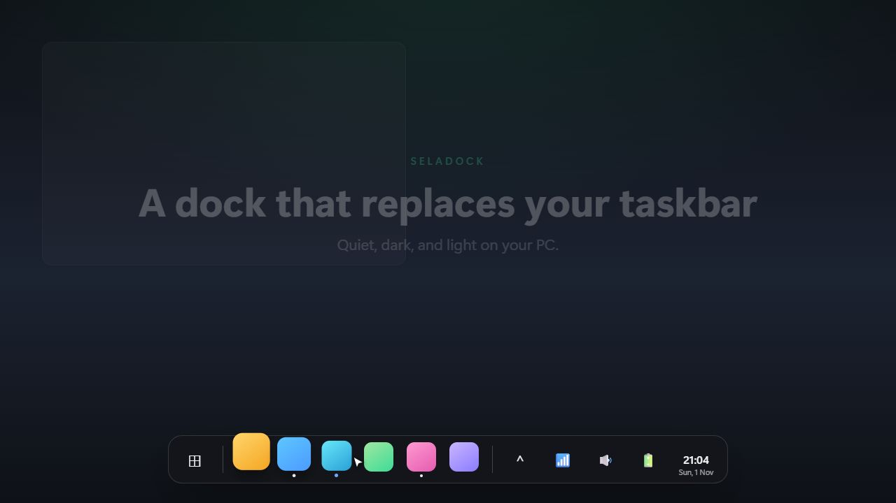
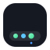

<p align="center">
  <a href="https://agusumri.github.io/seladock/"></a>
</p>

<p align="center">
  
</p>

<h1 align="center">SelaDock</h1>

<p align="center">
  A dock that replaces your taskbar, quietly.<br>
  A dark glass bar at the bottom of your Windows screen for your apps, open windows, tray, and the time.<br><br>
  <a href="https://agusumri.github.io/seladock/"><b>Visit the website →</b></a>
</p>

<p align="center">
  <a href="https://agusumri.github.io/seladock/"></a>
  <a href="https://github.com/agusumri/seladock/releases"></a>
  
  
</p>

SelaDock sits at the bottom of your screen as a rounded, translucent bar. It shows your pinned apps, the windows you have open, a tray flyout, network, volume, battery, and the clock. While it runs, it hides the Windows taskbar, and it gives the taskbar back when you quit. It's a separate app from the [Sela](https://github.com/agusumri/sela) notch, built on the same stack.

<p align="center">
  <a href="docs/assets/media/seladock.mp4"><b>▶ Watch the motion video</b></a>
</p>

## Features

- **Replaces the taskbar**: the Windows taskbar stays hidden while SelaDock runs, even when you open Start, Quick Settings, or the calendar. Quit SelaDock and the taskbar comes back.
- **Apps stop above the dock**: maximized windows end exactly at the top of the dock, like they do with the taskbar, so nothing you type is hidden behind it.
- **Start button** that opens the real Windows Start menu.
- **Pinned apps**: on first run, SelaDock copies the apps you pinned to the Windows taskbar. Drag an `.exe` or a shortcut onto the dock to pin it, drag a pinned icon to reorder it, and right-click to unpin.
- **Open windows**: each app shows a dot when it's running and a highlight when it's active. Click to focus an app, click again to minimize it.
- **Tray flyout**: the **^** button lists apps that run in the background, such as VPN clients and sync tools. Click one to bring its window forward.
- **System buttons**: network, volume, and battery open the genuine Windows panels.
- **Clock**: shows the time and date. Click it to open the calendar.
- **Dark menus** that match the dock, for the tray menu and right-click menus.
- **Sizes**: Auto (fits your screen), Small, Medium, or Large.
- **Light on your PC**: SelaDock reacts to window events instead of polling, so it does almost no work while your desktop is idle.

## Download and run

SelaDock runs on Windows 10 or 11 (64-bit). You don't need to install .NET.

1. Open the [releases page](https://github.com/agusumri/seladock/releases) and download `SelaDock.exe`. If no release is published yet, [build it from source](#build-from-source).
2. Run `SelaDock.exe`. The dock appears at the bottom of the screen, the Windows taskbar hides, and the SelaDock icon appears in the notification area.

> [!NOTE]
> Release files aren't digitally signed yet, so Windows SmartScreen might show a warning. Click **More info**, then **Run anyway**.

To quit, right-click the SelaDock icon in the notification area, then click **Quit SelaDock**. The Windows taskbar comes back.

## Use the dock

Right-click the SelaDock icon in the notification area to change these options:

| Option | What it does |
| --- | --- |
| **Dock size** | Sets the icon size: **Auto (fit screen)**, **Small**, **Medium**, or **Large**. |
| **Auto-hide dock** | Slides the dock off screen until you point at the bottom edge. Maximized windows then use the full screen. |
| **Reserve space (apps stop above dock)** | On by default. Turn it off to let maximized windows run under the dock. |
| **Quit SelaDock** | Closes the dock and shows the Windows taskbar again. |

Your settings and pinned apps are stored in `%APPDATA%\SelaDock\settings.json`. To reset SelaDock, quit it and delete that folder.

### About tray icons on Windows 11

Windows 11 draws third-party tray icons inside Explorer, and it offers no supported way for another app to show or click them. So the **^** flyout lists the background apps themselves instead of their tray icons. When you click one, SelaDock does one of the following:

- If the app's window is open but behind other windows, SelaDock brings it to the front.
- If the app hid its window, SelaDock shows it again.
- If the app has no window yet, SelaDock starts the app again. Most tray apps allow only one copy, so the running copy opens its window.

## For developers

SelaDock is written in C# with WPF on .NET 10, and it talks to Windows through Win32 interop.

| Folder | Contents |
| --- | --- |
| `src/SelaDock/Interop` | Win32 calls: window enumeration, focus, icons, app bar, event hooks |
| `src/SelaDock/Services` | Windows and icons, taskbar hiding, reserved screen space, tray flyout, system panels, settings, tray menu |
| `src/SelaDock/ViewModel` | Dock items (pinned, running, active), the clock, and system indicators |
| `src/SelaDock/Views` | The dock window: layout, hover magnification, auto-hide, drag and drop |
| `docs` | The website, published with GitHub Pages |
| `video` | The [Remotion](https://www.remotion.dev/) project that renders the motion video |

### Build from source

Before you begin, install the [.NET 10 SDK](https://dotnet.microsoft.com/download/dotnet/10.0).

To build and start the dock, run the following commands:

```powershell
dotnet build src/SelaDock/SelaDock.csproj
dotnet run --project src/SelaDock/SelaDock.csproj
```

To create a single self-contained `SelaDock.exe` in `dist/publish`, run the following command:

```powershell
dotnet publish src/SelaDock/SelaDock.csproj -p:PublishProfile=win-x64
```

### Render the video

The video in `docs/assets/media` comes from the `video` project. To render it again, install [Node.js](https://nodejs.org/), then run the following commands:

```powershell
cd video
npm install
node render.mjs
```

## Ideas for later

- Window thumbnail previews on hover.
- Multi-monitor placement.
- A settings window.
